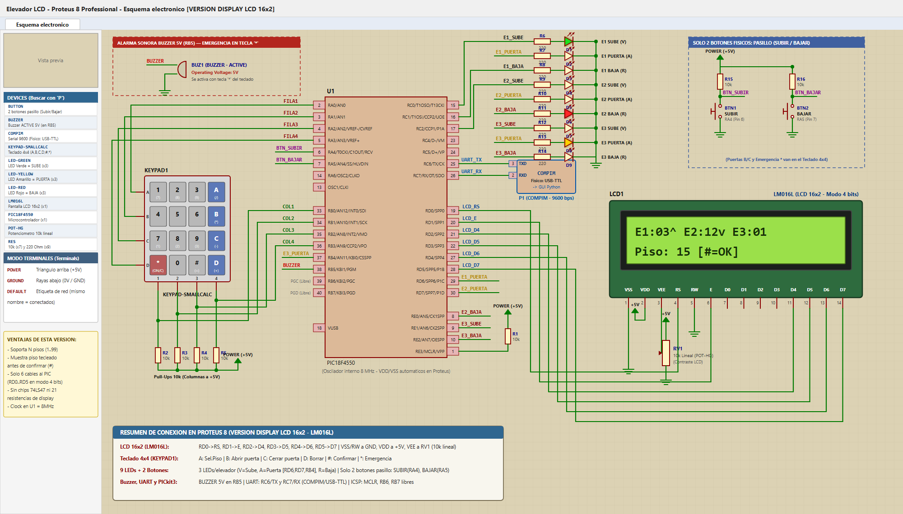
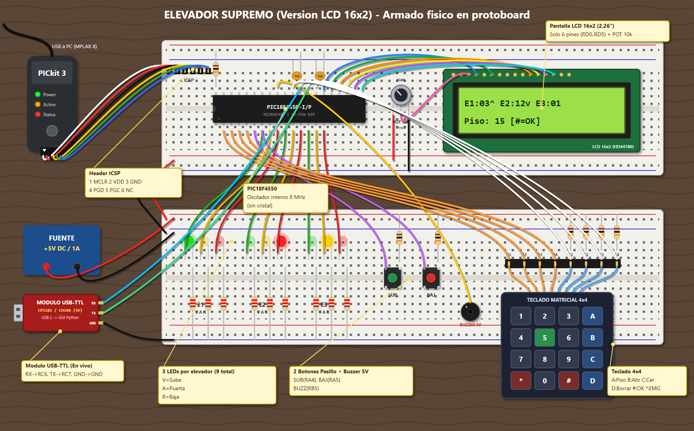

# Elevador Supremo — Versión Display LCD 16x2 (`LM016L`)

Versión definitiva para controlar **3 elevadores para $N$ pisos (por defecto $N = 12$)** con **PIC18F4550**, **PICkit™ 3**, **Pantalla LCD 16x2 (`LM016L`)**, **Teclado Matricial 4x4**, **2 Botones de Pasillo (`SUBIR` / `BAJAR`)**, **9 LEDs** (3 por elevador: Verde = Sube, Amarillo = Puerta abierta, Rojo = Baja), **Buzzer 5 V** y **UART (`COMPIM` / Módulo USB-TTL)** para la interfaz en Python.

---

## 1. Lista de Materiales y Nombres Exactos en Proteus 8

| Elemento | Nombre exacto en Proteus (`P`) | Cant. | Función / Conexión |
| :--- | :--- | :---: | :--- |
| **Microcontrolador** | `PIC18F4550` | **1** | Oscilador interno a $8\text{ MHz}$ (`INTOSC`). En Proteus: `Processor Clock = 8MHz`. |
| **Pantalla LCD 16x2** | `LM016L` | **1** | `RD0..RD5` $\rightarrow$ `RS, E, D4, D5, D6, D7` (modo 4 bits). `VSS`/`RW` a `GROUND`, `VDD` a `POWER`. |
| **Potenciómetro 10k lineal (`B10K`)** | `POT-HG` (`10k`) | **1** | Extremos a `POWER` ($+5\text{V}$) y `GROUND`, cursor central al pin `VEE` (Pin 3 del LCD). |
| **Teclado Matricial 4x4** | `KEYPAD-SMALLCALC` | **1** | Filas `A–D` a `RA0..RA3`; Columnas `1–4` a `RB0..RB3` (+ 4 pull-ups `10k`). **Funciones:** `A`=Selección piso, `B`=Abrir puerta, `C`=Cerrar puerta, `D`=Borrar, `#`=Confirmar, `*`=Emergencia. |
| **Botones de Pasillo** | `BUTTON` | **2** | **`BTN1` (`SUBIR`)** en `RA4` (Pin 6) y **`BTN2` (`BAJAR`)** en `RA5` (Pin 7), con pull-up `10k`. |
| **LEDs Verdes (Sube)** | `LED-GREEN` | **3** | `RC0` (`E1`), `RC2` (`E2`), `RE1` (`E3`) $\rightarrow$ `220 Ω` $\rightarrow$ `GROUND`. |
| **LEDs Amarillos (Espera / Puerta)** | `LED-YELLOW` | **3** | `RD6` (`E1`), `RD7` (`E2`), `RB4` (`E3`) $\rightarrow$ `220 Ω` $\rightarrow$ `GROUND` (**parpadea** mientras espera). |
| **LEDs Rojos (Baja)** | `LED-RED` | **3** | `RC1` (`E1`), `RE0` (`E2`), `RE2` (`E3`) $\rightarrow$ `220 Ω` $\rightarrow$ `GROUND`. |
| **Buzzer Activo 5 V** | `BUZZER` (`ACTIVE`, `5V`) | **1** | Entre `RB5` (Pin 38) y `GROUND`. Suena al activar emergencia (`*`) y al llegar a un piso. |
| **Puerto Serial (GUI Python)** | `COMPIM` *(físico: USB-TTL `CP2102`/`CH340`)* | **1** | `RC6/TX` (Pin 25) y `RC7/RX` (Pin 26) a `9600 bps`. |
| **Resistencias** | `RES` | **16** | **7** de **`10k`** (4 pull-ups teclado + 2 botones pasillo + 1 `MCLR`) y **9** de **`220`** (para los 9 LEDs). |

---

## 2. Asignación de Pines del PIC18F4550

| Bloque | Pines en el PIC18F4550 | Conexión |
| :--- | :--- | :--- |
| **Pantalla LCD 16x2** | `RD0 (19)`, `RD1 (20)`, `RD2 (21)`, `RD3 (22)`, `RD4 (27)`, `RD5 (28)` | `RS`, `E`, `D4`, `D5`, `D6`, `D7`. |
| **Teclado 4x4** | `RA0..RA3` (2–5) / `RB0..RB3` (33–36) | Filas `A..D` / Columnas `1..4` (+ pull-up `10k`). |
| **Botones Pasillo** | `RA4 (6)`, `RA5 (7)` | `SUBIR` (▲) y `BAJAR` (▼) con pull-up `10k`. |
| **LEDs Elevador 1** | `RC0 (15)` Verde, `RD6 (29)` Amarillo, `RC1 (16)` Rojo | Sube / Puerta abierta / Baja (`220 Ω`). |
| **LEDs Elevador 2** | `RC2 (17)` Verde, `RD7 (30)` Amarillo, `RE0 (8)` Rojo | Sube / Puerta abierta / Baja (`220 Ω`). |
| **LEDs Elevador 3** | `RE1 (9)` Verde, `RB4 (37)` Amarillo, `RE2 (10)` Rojo | Sube / Puerta abierta / Baja (`220 Ω`). |
| **Buzzer 5 V** | `RB5 (38)` | Alarma de emergencia (`*`) y aviso de llegada. |
| **UART (GUI Python)** | `RC6/TX (25)`, `RC7/RX (26)` | `COMPIM` en Proteus / Módulo USB-TTL en físico (`9600 bps`). |
| **PICkit™ 3 (ICSP)** | `RE3/MCLR (1)`, `RB6/PGC (39)`, `RB7/PGD (40)` | `MCLR` con `10k` a `POWER`; `RB6` y `RB7` libres. |

---

## 3. Lógica de Funcionamiento Multi-Usuario

1. **Ubicación del usuario (`A` + piso + `#`):** el usuario presiona **`A`** para entrar a *Selección de piso*, teclea el piso donde se encuentra (`1..N`) y confirma con **`#`** (si el piso no existe, la LCD muestra **`ERROR:No existe!`**). **En este paso aún no se mueve ningún elevador.**
2. **Llamada en pasillo (`SUBIR` o `BAJAR`) — Despacho Óptimo Colectivo (SCAN/LOOK):** al presionar **`SUBIR` (`RA4`)** o **`BAJAR` (`RA5`)**, el sistema evalúa a **los 3 elevadores** (libres y en movimiento) y asigna la llamada al que **llegará más rápido** al usuario:
   - Si un elevador **en movimiento** está más cerca y va en la misma dirección hacia el piso del usuario, **se detiene de paso** para recogerlo en lugar de mandar un elevador lejano que esté quieto.
   - Si **los 3 elevadores están en movimiento**, la llamada nunca se rechaza: se agrega como parada al elevador más cercano según su ruta y sentido actual.
3. **Puerta abierta y encolado múltiple de destinos (sin presionar `A`):** al llegar por uno o varios usuarios, el elevador abre su puerta (**LED Amarillo ON**) y **no se cierra** hasta que se ingrese al menos un piso destino (`0–9` + `#`, sin presionar `A`). Cada vez que un usuario ingresa su destino con `#`, la petición **se encola** y se abre una ventana de ~4 s (reiniciable con cada dígito o con `B`) para que **otros usuarios que entraron al mismo tiempo** también ingresen sus pisos destino (o presionen `C` para cerrar y arrancar de inmediato). Luego el elevador cierra puertas y atiende toda la cola en orden óptimo.
4. **Simulación de varios usuarios simultáneos:** mientras un elevador está viajando o atendiendo a un usuario, se puede presionar **`A`** nuevamente para registrar otro usuario en otro piso y despachar el siguiente elevador libre más cercano.
5. **Otras teclas:** **`B`** abrir puerta, **`C`** cerrar puerta manualmente, **`D`** borrar si te equivocas al ingresar el piso, **`*`** paro de emergencia (`BUZZER` 5 V + LEDs rojos parpadeando).

---

## 4. Bocetos Visuales Actualizados

### A. Ilustración en Proteus 8 Professional (`LM016L` + 9 LEDs + 2 Botones + `COMPIM`)

### B. Armado físico en protoboard (con PICkit™ 3 y Módulo USB-TTL)

