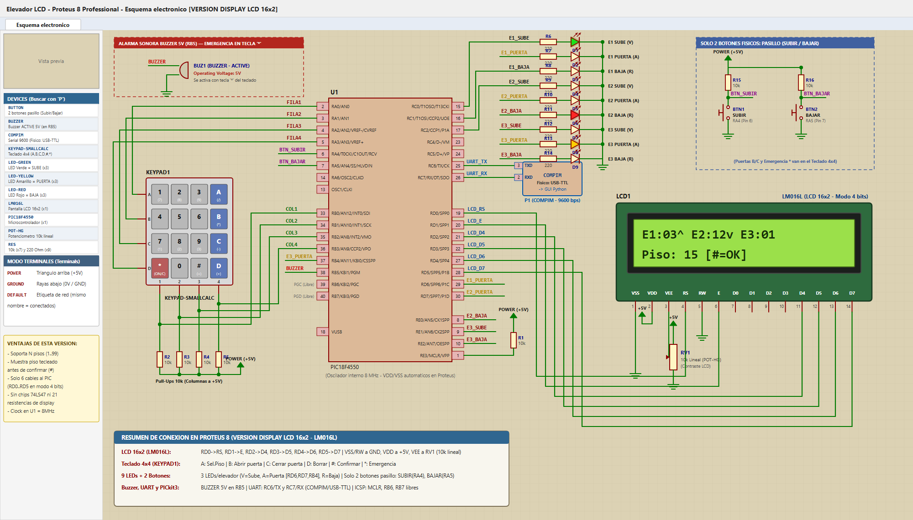

# Elementos en Proteus 8 — Elevador Supremo (Versión Display LCD 16x2)

## 1. Componentes en el botón `P` (*Modo Componentes* $\rightarrow$ `DEVICES`)

| Elemento | Nombre exacto en Proteus (`Keywords`) | Cant. | Configuración y conexión |
| :--- | :--- | :---: | :--- |
| **Microcontrolador** | `PIC18F4550` | **1** | `Processor Clock Frequency`: **`8MHz`** y cargar `.hex`. |
| **Pantalla LCD 16x2** | `LM016L` | **1** | `RD0..RD5` $\rightarrow$ `RS, E, D4..D7`; `VSS`/`RW` a `GROUND`; `VDD` a `POWER`. |
| **Potenciómetro 10k lineal** | `POT-HG` | **1** | `Resistance`: **`10k`**. Extremos a `POWER`/`GROUND`, centro a `VEE` del `LM016L`. |
| **Teclado Matricial 4x4** | `KEYPAD-SMALLCALC` | **1** | Filas `A..D` a `RA0..RA3`; Columnas `1..4` a `RB0..RB3` (+ 4 pull-ups `10k`). `A`=Sel. piso, `B`=Abrir puerta, `C`=Cerrar puerta, `D`=Borrar, `#`=Confirmar, `*`=Emergencia. |
| **Botones de Pasillo** | `BUTTON` | **2** | `BTN1` (`SUBIR`) $\rightarrow$ `RA4` y `BTN2` (`BAJAR`) $\rightarrow$ `RA5` (ambos con pull-up `10k`). |
| **Buzzer 5 V** | `BUZZER` *(librería `ACTIVE`)* | **1** | `Operating Voltage = 5V`. Patita arriba a `RB5`, patita abajo a `GROUND`. |
| **LED Verde (Sube)** | `LED-GREEN` | **3** | `RC0` (E1), `RC2` (E2), `RE1` (E3) $\rightarrow$ `220 Ω` $\rightarrow$ `GROUND`. |
| **LED Amarillo (Puerta Abierta)** | `LED-YELLOW` | **3** | `RD6` (E1), `RD7` (E2), `RB4` (E3) $\rightarrow$ `220 Ω` $\rightarrow$ `GROUND`. |
| **LED Rojo (Baja)** | `LED-RED` | **3** | `RC1` (E1), `RE0` (E2), `RE2` (E3) $\rightarrow$ `220 Ω` $\rightarrow$ `GROUND`. |
| **Resistencias** | `RES` | **16** | **7** de **`10k`** (4 teclado + 2 botones + 1 `MCLR`) y **9** de **`220`** (para los 9 LEDs). |
| **Puerto Serial (GUI Python)** | `COMPIM` *(físico: USB-TTL)* | **1** | `RC6/TX` $\rightarrow$ Pin 3 (`TXD`), `RC7/RX` $\rightarrow$ Pin 2 (`RXD`), `9600 bps`. |

## 2. Referencia Visual en Proteus 8

