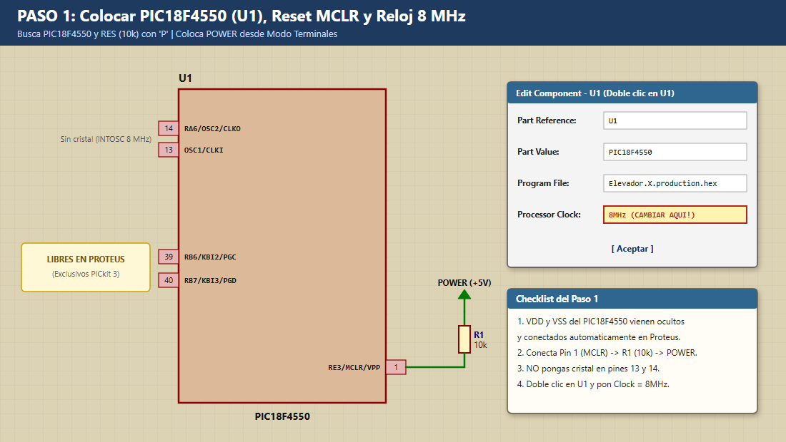
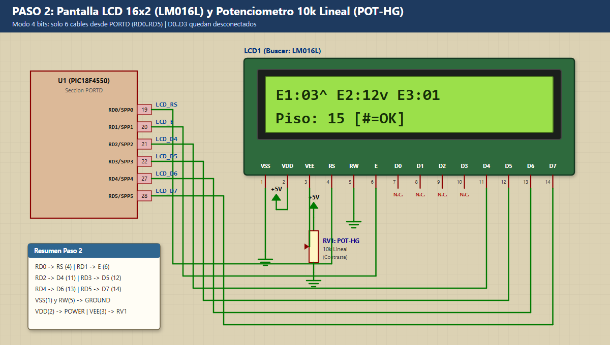
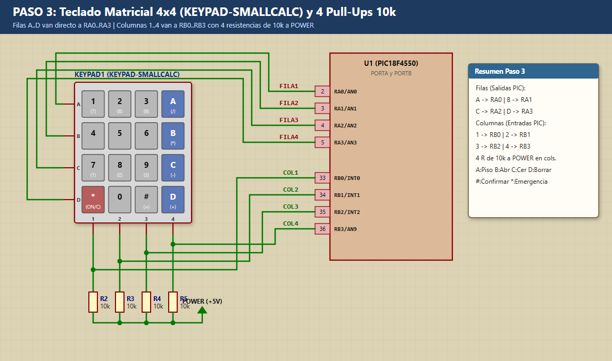
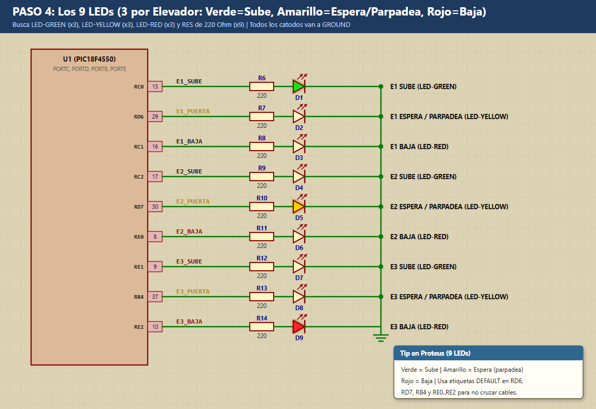
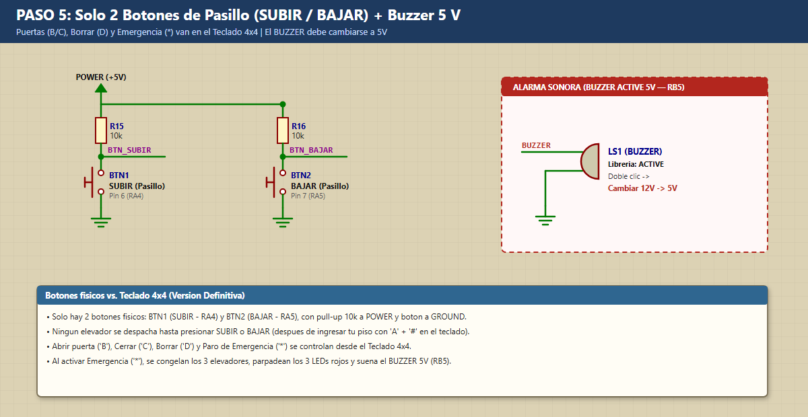
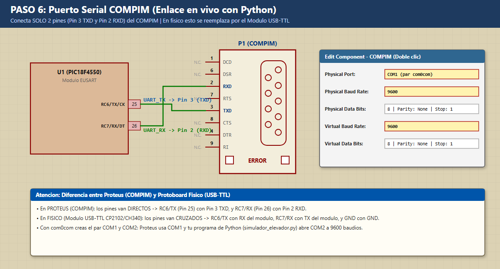
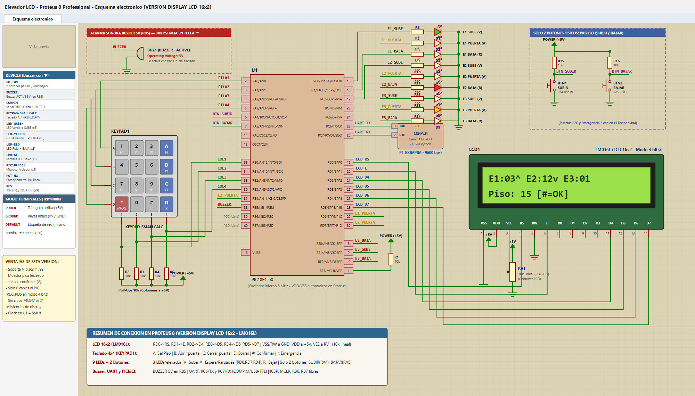

# Tutorial Paso a Paso en Proteus 8 — Elevador Supremo (Versión Display LCD 16x2)

Esta guía te lleva **parte por parte** para armar el circuito completo del **Elevador Supremo** (3 elevadores, $N$ pisos, Pantalla LCD 16x2, Teclado 4x4, **2 Botones de Pasillo**, Buzzer 5 V, **9 LEDs** y `COMPIM` para Python) en **Proteus 8 Professional** usando el **PIC18F4550**.

---

## Preparación: Agregar los 11 componentes en `DEVICES`

En Proteus 8, selecciona el **Modo Componentes** (barra izquierda) y presiona la tecla **`P`** (*Pick Devices*) para agregar uno por uno:

1. `PIC18F4550` (x1)
2. `LM016L` (x1 — Pantalla LCD 16x2)
3. `POT-HG` (x1 — Potenciómetro 10k lineal interactivo)
4. `KEYPAD-SMALLCALC` (x1 — Teclado matricial 4x4: `A`=Sel.Piso, `B`=Abrir, `C`=Cerrar, `D`=Borrar, `#`=Confirmar, `*`=Emergencia)
5. `BUTTON` (x2 — solo **`SUBIR`** y **`BAJAR`** en pasillo)
6. `BUZZER` (x1 — Alarma sonora 5 V, librería `ACTIVE`)
7. `LED-GREEN` (x3 — Sube)
8. `LED-YELLOW` (x3 — Espera / Puerta abierta, **parpadea**)
9. `LED-RED` (x3 — Baja)
10. `RES` (x16 — **7** de `10k` y **9** de `220`)
11. `COMPIM` (x1 — Puerto serial 9600 bps para enlazar con Python)

*(Los símbolos `POWER`, `GROUND` y etiquetas `DEFAULT` se sacan del **Modo Terminales** en la barra izquierda).*

---

## Paso 1: Colocar el `PIC18F4550` (`U1`), Reset `MCLR` y Reloj a `8MHz`

1. Coloca **`PIC18F4550` (`U1`)** justo en el centro de tu hoja.
2. En el **Pin 1 (`RE3/MCLR/VPP`)** (esquina inferior derecha de `U1`), coloca una resistencia **`RES` (`R1`)** con valor **`10k`** conectada hacia un terminal **`POWER`** (`+5V`).
3. **No pongas cristal** en los pines 13 y 14 (usaremos el oscilador interno a `8 MHz`).
4. Deja libres los pines **`39 (RB6/PGC)`** y **`40 (RB7/PGD)`** (reservados para el **PICkit™ 3** en físico).
5. Haz **doble clic sobre `U1`**:
   - Cambia **`Processor Clock Frequency`** a **`8MHz`**.
   - Cuando compiles tu proyecto en MPLAB X, ahí mismo en **`Program File`** cargarás el archivo `.hex`.

---

## Paso 2: Conectar la Pantalla LCD 16x2 (`LM016L`) y el Potenciómetro (`POT-HG`)

1. Coloca **`LM016L` (`LCD1`)** a la derecha de `U1`.
2. Conecta la alimentación y control fijo del LCD:
   - Pin **`1 (VSS)`** y Pin **`5 (RW)`** $\rightarrow$ **`GROUND`**.
   - Pin **`2 (VDD)`** $\rightarrow$ **`POWER`** (`+5V`).
   - Pines **`7, 8, 9, 10 (D0, D1, D2, D3)`** $\rightarrow$ **Sin conectar** (modo 4 bits).
3. Coloca **`POT-HG` (`RV1`)** debajo de `VEE`, ponle valor **`10k`**:
   - Extremo superior $\rightarrow$ **`POWER`** (`+5V`).
   - Extremo inferior $\rightarrow$ **`GROUND`**.
   - Flecha central (cursor) $\rightarrow$ Pin **`3 (VEE)`** del `LM016L`.
4. Conecta los **6 cables de datos/control** desde **`PORTD`** de `U1`:
   - `RD0` (Pin 19) $\rightarrow$ **`RS`** (Pin 4 del LCD)
   - `RD1` (Pin 20) $\rightarrow$ **`E`** (Pin 6 del LCD)
   - `RD2` (Pin 21) $\rightarrow$ **`D4`** (Pin 11 del LCD)
   - `RD3` (Pin 22) $\rightarrow$ **`D5`** (Pin 12 del LCD)
   - `RD4` (Pin 27) $\rightarrow$ **`D6`** (Pin 13 del LCD)
   - `RD5` (Pin 28) $\rightarrow$ **`D7`** (Pin 14 del LCD)

---

## Paso 3: Conectar el Teclado Matricial 4x4 (`KEYPAD-SMALLCALC`) + 4 Pull-Ups `10k`

1. Coloca **`KEYPAD-SMALLCALC` (`KEYPAD1`)** a la izquierda de `U1`.
2. Conecta las **4 Filas (lado izquierdo del teclado: `A, B, C, D`)** directo a **`PORTA`**:
   - Fila **`A`** $\rightarrow$ **`RA0`** (Pin 2)
   - Fila **`B`** $\rightarrow$ **`RA1`** (Pin 3)
   - Fila **`C`** $\rightarrow$ **`RA2`** (Pin 4)
   - Fila **`D`** $\rightarrow$ **`RA3`** (Pin 5)
3. Conecta las **4 Columnas (parte inferior del teclado: `1, 2, 3, 4`)** directo a **`PORTB`**:
   - Columna **`1`** $\rightarrow$ **`RB0`** (Pin 33)
   - Columna **`2`** $\rightarrow$ **`RB1`** (Pin 34)
   - Columna **`3`** $\rightarrow$ **`RB2`** (Pin 35)
   - Columna **`4`** $\rightarrow$ **`RB3`** (Pin 36)
4. Agrega **4 resistencias `RES` (`R2–R5`) de `10k`** conectando cada línea de columna (`1, 2, 3, 4`) hacia **`POWER`** (`+5V`). *(Sin estos pull-ups el teclado leerá ruido).*

---

## Paso 4: Conectar los 9 LEDs (3 por Elevador: Verde = Sube, Amarillo = Espera/Parpadea, Rojo = Baja)

1. Arriba a la derecha de `U1`, coloca **9 resistencias `RES` (`R6–R14`) de `220`**, seguidas por **3 `LED-GREEN`** (Sube), **3 `LED-YELLOW`** (Espera / Puerta abierta — **parpadea** mientras espera) y **3 `LED-RED`** (Baja).
2. Une todos los cátodos (lado de la raya del LED) juntos hacia un solo **`GROUND`**.
3. Conecta cada resistencia a su pin del `PIC18F4550`:
   - **Elevador 1:** `RC0` (Pin 15) $\rightarrow$ **`LED-GREEN` (Sube)** | `RD6` (Pin 29, `E1_PUERTA`) $\rightarrow$ **`LED-YELLOW` (Espera/Parpadea)** | `RC1` (Pin 16) $\rightarrow$ **`LED-RED` (Baja)**
   - **Elevador 2:** `RC2` (Pin 17) $\rightarrow$ **`LED-GREEN` (Sube)** | `RD7` (Pin 30, `E2_PUERTA`) $\rightarrow$ **`LED-YELLOW` (Espera/Parpadea)** | `RE0` (Pin 8, `E2_BAJA`) $\rightarrow$ **`LED-RED` (Baja)**
   - **Elevador 3:** `RE1` (Pin 9, `E3_SUBE`) $\rightarrow$ **`LED-GREEN` (Sube)** | `RB4` (Pin 37, `E3_PUERTA`) $\rightarrow$ **`LED-YELLOW` (Espera/Parpadea)** | `RE2` (Pin 10, `E3_BAJA`) $\rightarrow$ **`LED-RED` (Baja)**

---

## Paso 5: Conectar los 2 Botones de Pasillo (`BUTTON`) y el `BUZZER` 5 V

1. Coloca **solo 2 bloques Pull-Up iguales**: `POWER` $\rightarrow$ **`RES` (`10k`)** $\rightarrow$ nodo con etiqueta $\rightarrow$ **`BUTTON`** $\rightarrow$ **`GROUND`**.
2. Pon el **mismo nombre de etiqueta** (`LBL` o terminal `DEFAULT`) en el botón y en el pin correspondiente de `U1`:
   - **`BTN_SUBIR`** (`BTN1`, Pasillo ▲) $\rightarrow$ **`RA4`** (Pin 6)
   - **`BTN_BAJAR`** (`BTN2`, Pasillo ▼) $\rightarrow$ **`RA5`** (Pin 7)
   - *(Ya no hay botones físicos aparte para abrir, cerrar ni emergencia: **`A`** selecciona piso, **`B`** abre puerta, **`C`** cierra puerta, **`D`** borra si te equivocas, **`#`** confirma y **`*`** activa el paro de emergencia).*
3. Coloca **`BUZZER` (`LS1`, librería `ACTIVE`)**:
   - Un lado con etiqueta **`BUZZER`** hacia **`RB5`** (Pin 38) de `U1`.
   - El otro lado a **`GROUND`**.
   - **Paso obligatorio:** Haz **doble clic en el `BUZZER`** y cambia **`Operating Voltage`** de `12V` a **`5V`** (si no lo cambias, no sonará).

---

## Paso 6: Conectar el Puerto Serial `COMPIM` (Para usar tu Interfaz en Python)

1. Coloca **`COMPIM` (`P1`)** a la derecha de `U1`, cerca de `RC6` y `RC7`.
2. Conecta **únicamente estos 2 pines** (deja los otros 6 sin conectar):
   - **`RC6/TX/CK`** (Pin 25 de `U1`) $\rightarrow$ **Pin `3 (TXD)`** del `COMPIM`.
   - **`RC7/RX/DT`** (Pin 26 de `U1`) $\rightarrow$ **Pin `2 (RXD)`** del `COMPIM`.
3. Haz **doble clic en `COMPIM`** y configura:
   - `Physical Port`: **`COM1`** *(creado con `com0com` junto a su par `COM2` para Python)*
   - `Physical Baud Rate`: **`9600`**
   - `Virtual Baud Rate`: **`9600`**
   - Data Bits: `8`, Parity: `None`, Stop Bits: `1`.

---

## Vista Final Completa en Proteus 8

Al terminar los 6 pasos, tu esquema completo debe lucir así:

