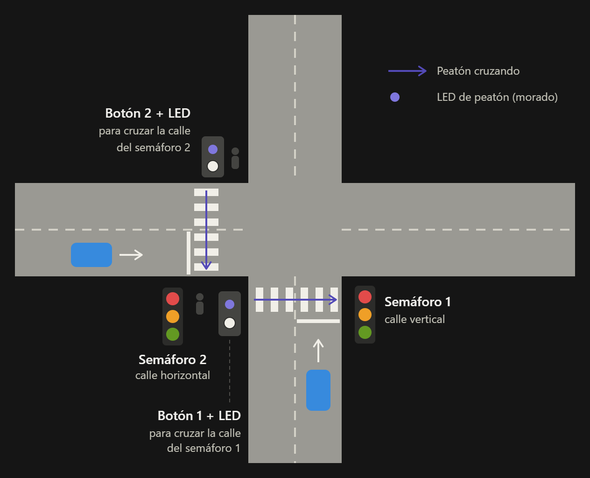

# Sémaforo supremo



Cuales usamos :)


## Asignación de pines :b

### Semáforo 1

| Señal | Pin | Puerto | Tipo |
| --- | --- | --- | --- |
| Verde_1 | 19 | RD0 | Salida |
| Amarillo_1 | 20 | RD1 | Salida |
| Rojo_1 | 21 | RD2 | Salida |
| Led_Peaton_1 | 29 | RD6 | Salida |
| Boton_1 | 30 | RD7 | Entrada (10k a +5V, botón a GND) |

Actualización

| Señal | Pin | Puerto | Tipo |
| --- | --- | --- | --- |
| Verde_1 | 19 | RD0 | Salida |
| Amarillo_1 | 20 | RD1 | Salida |
| Rojo_1 | 21 | RD2 | Salida |
| Led_Peaton_1 | 37 | RB4 | Salida |
| Boton_1 | 2 | RA0 | Entrada  |

### Semáforo 2

| Señal | Pin | Puerto | Tipo |
| --- | --- | --- | --- |
| Rojo_2 | 22 | RD3 | Salida |
| Amarillo_2 | 27 | RD4 | Salida |
| Verde_2 | 28 | RD5 | Salida |
| Led_Peaton_2 | 15 | RC0 | Salida |
| Boton_2 | 16 | RC1 | Entrada (10k a +5V, botón a GND) |

Modificación

| Señal | Pin | Puerto | Tipo |
| --- | --- | --- | --- |
| Rojo_2 | 22 | RD3 | Salida |
| Amarillo_2 | 27 | RD4 | Salida |
| Verde_2 | 28 | RD5 | Salida |
| Led_Peaton_2 | 29 | RD6 | Salida |
| Boton_2 | 30 | RD7 | Entrada (10k a +5V, botón a GND) |

### Alimentación y soporte (qn sabe si esto sirve)

| Pin | Conexión |
| --- | --- |
| 11 y 32 | VDD (+5V) |
| 12 y 31 | VSS (GND) |
| 1 (MCLR) | 10k a +5V, y también al PICkit 3 |
| 13 y 14 | Libres (oscilador interno) |

**Este habia pero ps ya no: Amarillo_2 en RC5/D+/VP (pin 24): no funciona como salida.**

Recordar que:

| 0 | OUTPUT |
| --- | --- |
| 1 | INPUT |

Momento de programar 

| Registro | Para qué sirve | Valores | Ejemplo |
| --- | --- | --- | --- |
| `TRISx` | Elegir la dirección del pin | 0 = salida, 1 = entrada | `TRISDbits.TRISD0 = 0;` |
| `LATx` | Escribir en un pin de salida | 1 = 5 V, 0 = 0 V | `LATDbits.LATD0 = 1;` |
| `PORTx` | Leer el valor de un pin de entrada | 1 = hay 5 V, 0 = hay 0 V | `if(PORTDbits.RD7 == 0)` |

| Qué quieres | Forma de escribirlo |
| --- | --- |
| Dirección de un pin | `TRISDbits.TRISD0` |
| Escribir un pin | `LATDbits.LATD0` |
| Leer un pin | `PORTDbits.RD0` |

## Reglas importantes

1. **Primero configura, luego usa.** Todo pin necesita su `TRIS` antes de escribir o leer.
2. **Escribe en LAT, lee en PORT.** Para prender un LED usa `LATD`, para leer un botón usa `PORTD`.
3. **Con el pull-up de tu circuito, el botón da 0 al presionarse** y 1 cuando está suelto.
4. **PORTA y PORTB arrancan con pines analógicos.** Si los usas como digitales necesitas `ADCON1 = 0x0F;`. PORTC y PORTD ya arrancan digitales.

# Códigos

## Version Anterior (Antes de cambiar los pines)

```jsx
/*
 * File:   main.c
 * Author: santo
 *
 * Dos semaforos con boton de peaton cada uno
 */

#define _XTAL_FREQ 8000000UL

#include "config.h"
#include <xc.h>

//Configuración para deshabilitar los pines en digital  
//TRISBbits.TRISB3=0;
//TRISB = 0x04; /* -> */ TRISB= 0b0000100; //Esto es igual 
//Esto manda un 1 al pin B3

/*
  Asignación de pines
  Semaforo 1: Verde RD0, Amarillo RD1, Rojo RD2, Led peaton RD6, Boton RD7
  Semaforo 2: Verde RD5, Amarillo RD4, Rojo RD3, Led peaton RC0, Boton RC1
  Botones con pull-up: 
  -Sin presionar = 1
  -Presionado = 0
 */

// 1 = hay un peaton esperando
//funciones globales para no perder su valor  
int peaton_1 = 0;
int peaton_2 = 0;

/* Función que recibe la cantidad de milisegundos que tendrá que verificar 
si no hay un peaton esperando*/
void espera_ms(int ms){
    for(int i=0; i<ms; i++){
        //Checa si el boton de semaforo 1 ha sido presionado
        if(PORTDbits.RD7 == 0){
            peaton_1 = 1;
            LATDbits.LATD6 = 1;     //Prende led del peaton 1
        }
        //Checa si el boton de semaforo 2 ha sido presionado
        if(PORTCbits.RC1 == 0){
            peaton_2 = 1;
            LATCbits.LATC0 = 1;     //Prende led del peaton 2
        }
        __delay_ms(1);
    }
}

void main(void) {
    // Selecciona 8Mhz en los registros 
    OSCCONbits.IRCF =0b111;

    //LEDS, se declara que son de tipo salida
    //Semaforo 1
    TRISDbits.TRISD0 = 0; //Verde
    TRISDbits.TRISD1 = 0; //Amarillo
    TRISDbits.TRISD2 = 0; //Rojo
    TRISDbits.TRISD6 = 0; //Peaton_led
    
    //Semaforo 2
    TRISDbits.TRISD3 = 0; //Rojo
    TRISDbits.TRISD4 = 0; //Amarillo
    TRISDbits.TRISD5 = 0; //Verde
    TRISCbits.TRISC0 = 0; //Peaton_led

    //Botones
    TRISDbits.TRISD7 = 1; //Boton 1
    TRISCbits.TRISC1 = 1;   //Boton 2

    //Empieza con el rojo del semaforo 2 prendido
    LATDbits.LATD3=1;

    while(1){
        //Prende el verde 1
        LATDbits.LATD0=1;
        espera_ms(7000);
        //Apaga el verde 1
        LATDbits.LATD0=0;
        //Parpadeo antes de que cambie a amarillo_1
        for(int i=0; i<5; i++){
            //Prende el verde 1
            LATDbits.LATD0=1;
            espera_ms(500);
            //Apaga el verde 1
            LATDbits.LATD0=0;
            espera_ms(500);
        }
        //Prende el amarillo_1
        LATDbits.LATD1=1;
        espera_ms(5000);
        //Apaga el amarillo_1
        LATDbits.LATD1=0;
        //Prende el rojo 1
        LATDbits.LATD2=1;

        //Si el peaton 2 oprimio, se alarga el rojo del semaforo 2
        if(peaton_2 == 1){
            espera_ms(5000);
            peaton_2 = 0;
            LATCbits.LATC0=0;//Apaga el led del peaton
        }
        //Apaga el rojo 2
        LATDbits.LATD3=0;

        //Semaforo 2
        //Prende el verde 2
        LATDbits.LATD5=1;
        espera_ms(7000);
        //Apaga el verde 2
        LATDbits.LATD5=0;
        //Parpadeo antes de que cambie a amarillo_2
        for(int i=0; i<5; i++){
            //Prende el verde_2
            LATDbits.LATD5=1;
            espera_ms(500);
            //Apaga el verde_2
            LATDbits.LATD5=0;
            espera_ms(500);
        }
        LATDbits.LATD4=1;//Prende el Amarillo_2
        espera_ms(5000);
        LATDbits.LATD4=0;//Apaga el Amarillo_2
        //Prende el rojo_2
        LATDbits.LATD3=1;

        //Si el peaton 1 oprimio, se alarga el rojo del semaforo 1
        if(peaton_1 == 1){
            espera_ms(5000);
            peaton_1 = 0;
            LATDbits.LATD6=0; //Apaga el led del peaton 1
        }
        //Apaga el rojo 1
        LATDbits.LATD2=0;
    }
    return;
}
```

# Versión después de cambiar los pines

```c
/*
 * File:   main.c
 * Author: santo
 *
 * Dos semaforos con boton de peaton cada uno
 */

#define _XTAL_FREQ 8000000UL

#include "config.h"
#include <xc.h>

//Configurar con digital es para eso esta función
void Interrupt_Init(void){
    ADCON1bits.PCFG = 0b1111; //OxF
    TRISBbits.RB0 = 1; //Entrada de interrupciones 
    INTCON2bits.INTEDG0=0; //falling edge
}

//Configuración para deshabilitar los pines en digital  
//TRISBbits.TRISB3=0;
//TRISB = 0x04; /* -> */ TRISB= 0b0000100; //Esto es igual 
//Esto manda un 1 al pin B3

/*
  Asignación de pines
  Semaforo 1: Verde RD0, Amarillo RD1, Rojo RD2, Led peaton RD6(ahora RB4),
 *  Boton RD7 (Ahora RA0)
  Semaforo 2: Verde RD5, Amarillo RD4, Rojo RD3, Led peaton RC0 (ahora D6),
 *  Boton RC1 (Ahora D7)
  Botones con pull-up: 
  -Sin presionar = 1
  -Presionado = 0
 */

// 1 = hay un peaton esperando
//funciones globales para no perder su valor  
 volatile int peaton_1 = 0;
volatile int peaton_2 = 0;

/* Función que recibe la cantidad de milisegundos que tendrá que verificar 
si no hay un peaton esperando*/
void espera_ms(int ms){
    for(int i=0; i<ms; i++){
        //Checa si el boton de semaforo 1 ha sido presionado
        if(PORTAbits.RA0 == 0){
            peaton_1 = 1;
            LATBbits.LATB4 = 1;     //Prende led del peaton 1
        }
        //Checa si el boton de semaforo 2 ha sido presionado
        if(PORTDbits.RD7 == 0){
            peaton_2 = 1;
            LATDbits.LATD6 = 1;     //Prende led del peaton 2
        }
        __delay_ms(1);
    }
}

void main(void) {
    
    // RA0 en digital (arranca como analogico)
    ADCON1 = 0x0F;
    CMCON  = 0x07;
    // Selecciona 8Mhz en los registros 
    OSCCONbits.IRCF =0b111;

    //LEDS, se declara que son de tipo salida
    //Semaforo 1
    TRISDbits.TRISD0 = 0; //Verde
    TRISDbits.TRISD1 = 0; //Amarillo
    TRISDbits.TRISD2 = 0; //Rojo
    TRISBbits.TRISB4 = 0; //Peaton_led //era d6
    
    //Semaforo 2
    TRISDbits.TRISD3 = 0; //Rojo
    TRISDbits.TRISD4 = 0; //Amarillo
    TRISDbits.TRISD5 = 0; //Verde
    TRISDbits.TRISD6 = 0; //Peaton_led

    //Botones
    TRISAbits.TRISA0 = 1; //Boton 1
    TRISDbits.TRISD7 = 1;   //Boton 2
    
    

    //Empieza con el rojo del semaforo 2 prendido
    LATDbits.LATD3=1;
    
   
    while(1){
        //Prende el verde 1
        LATDbits.LATD0=1;
        espera_ms(7000);
        //Apaga el verde 1
        LATDbits.LATD0=0;
        //Parpadeo antes de que cambie a amarillo_1
        for(int i=0; i<5; i++){
            //Prende el verde 1
            LATDbits.LATD0=1;
            espera_ms(500);
            //Apaga el verde 1
            LATDbits.LATD0=0;
            espera_ms(500);
        }
        //Prende el amarillo_1
        LATDbits.LATD1=1;
        espera_ms(5000);
        //Apaga el amarillo_1
        LATDbits.LATD1=0;
        //Prende el rojo 1
        LATDbits.LATD2=1;

        //Si el peaton 2 oprimio, se alarga el rojo del semaforo 2
        if(peaton_2 == 1){
            espera_ms(5000);
            peaton_2 = 0;
            LATDbits.LATD6=0;//Apaga el led del peaton
        }
        //Apaga el rojo 2
        LATDbits.LATD3=0;

        //Semaforo 2
        //Prende el verde 2
        LATDbits.LATD5=1;
        espera_ms(7000);
        //Apaga el verde 2
        LATDbits.LATD5=0;
        //Parpadeo antes de que cambie a amarillo_2
        for(int i=0; i<5; i++){
            //Prende el verde_2
            LATDbits.LATD5=1;
            espera_ms(500);
            //Apaga el verde_2
            LATDbits.LATD5=0;
            espera_ms(500);
        }
        LATDbits.LATD4=1;//Prende el Amarillo_2
        espera_ms(5000);
        LATDbits.LATD4=0;//Apaga el Amarillo_2
        //Prende el rojo_2
        LATDbits.LATD3=1;

        //Si el peaton 1 oprimio, se alarga el rojo del semaforo 1
        if(peaton_1 == 1){
            espera_ms(5000);
            peaton_1 = 0;
            LATBbits.LATB4=0; //Apaga el led del peaton 1 //Antes d6
        }
        //Apaga el rojo 1
        LATDbits.LATD2=0;
    }
    return;
}
```

# Versión después de poner lo nuevo visto en clase

```c
/*
 * File:   main.c
 * Author: santo
 *
 * Dos semaforos con boton de peaton cada uno
 */
#define _XTAL_FREQ 8000000UL
#include "config.h"
#include <xc.h>

volatile  int8_t flag_peaton = 0;

//Configurar con digital es para eso esta función
void Interrupt_Init(void){
    ADCON1bits.PCFG = 0b1111; //OxF
    TRISBbits.RB0 = 1; //Entrada de interrupciones 
    INTCON2bits.INTEDG0=0; //fallingDown
    
    INTCONbits.INT0F =0; //Limpiamos la flag
    INTCONbits.INT0E =1; //Habilitamos el INT0
    INTCONbits.GIE =1; //Interrupciones globales 
}

/* Rutina de Servicio de Interrupcion (ISR)
 Actua como el callback asincrono del hardware.
 */
void __interrupt ISR(void){
    if(INTCONbits.INT0F  == 1){
        flag_peaton=1; Avisamos al codigo principal de la interrupción
        INTCONbits.INT0F = 0; //Volvemos a limpiar la flasg
    } 
}
//Configuración para deshabilitar los pines en digital  
//TRISBbits.TRISB3=0;
//TRISB = 0x04; /* -> */ TRISB= 0b0000100; //Esto es igual 
//Esto manda un 1 al pin B3

/*
  Asignación de pines
  Semaforo 1: Verde RD0, Amarillo RD1, Rojo RD2, Led peaton RD6(ahora RB4),
 *  Boton RD7 (Ahora RA0)
  Semaforo 2: Verde RD5, Amarillo RD4, Rojo RD3, Led peaton RC0 (ahora D6),
 *  Boton RC1 (Ahora D7)
  Botones con pull-up: 
  -Sin presionar = 1
  -Presionado = 0
 */

// 1 = hay un peaton esperando
//funciones globales para no perder su valor  
 volatile int peaton_1 = 0;
volatile int peaton_2 = 0;

/* Función que recibe la cantidad de milisegundos que tendrá que verificar 
si no hay un peaton esperando*/
void espera_ms(int ms){
    for(int i=0; i<ms; i++){
        //Checa si el boton de semaforo 1 ha sido presionado
        if(PORTAbits.RA0 == 0){
            peaton_1 = 1;
            LATBbits.LATB4 = 1;     //Prende led del peaton 1
        }
        //Checa si el boton de semaforo 2 ha sido presionado
        if(PORTDbits.RD7 == 0){
            peaton_2 = 1;
            LATDbits.LATD6 = 1;     //Prende led del peaton 2
        }
        __delay_ms(1);
    }
}

void main(void) {
    
    // Selecciona 8Mhz en los registros 
    OSCCONbits.IRCF =0b111;

    //LEDS, se declara que son de tipo salida
    //Semaforo 1
    TRISDbits.TRISD0 = 0; //Verde
    TRISDbits.TRISD1 = 0; //Amarillo
    TRISDbits.TRISD2 = 0; //Rojo
    TRISBbits.TRISB4 = 0; //Peaton_led //era d6
    
    //Semaforo 2
    TRISDbits.TRISD3 = 0; //Rojo
    TRISDbits.TRISD4 = 0; //Amarillo
    TRISDbits.TRISD5 = 0; //Verde
    TRISDbits.TRISD6 = 0; //Peaton_led

    //Botones
    TRISAbits.TRISA0 = 1; //Boton 1
    TRISDbits.TRISD7 = 1;   //Boton 2
    
    

    //Empieza con el rojo del semaforo 2 prendido
    LATDbits.LATD3=1;
    
   
    while(1){
        //Prende el verde 1
        LATDbits.LATD0=1;
        espera_ms(7000);
        //Apaga el verde 1
        LATDbits.LATD0=0;
        //Parpadeo antes de que cambie a amarillo_1
        for(int i=0; i<5; i++){
            //Prende el verde 1
            LATDbits.LATD0=1;
            espera_ms(500);
            //Apaga el verde 1
            LATDbits.LATD0=0;
            espera_ms(500);
        }
        //Prende el amarillo_1
        LATDbits.LATD1=1;
        espera_ms(5000);
        //Apaga el amarillo_1
        LATDbits.LATD1=0;
        //Prende el rojo 1
        LATDbits.LATD2=1;

        //Si el peaton 2 oprimio, se alarga el rojo del semaforo 2
        if(peaton_2 == 1){
            espera_ms(5000);
            peaton_2 = 0;
            LATDbits.LATD6=0;//Apaga el led del peaton
        }
        //Apaga el rojo 2
        LATDbits.LATD3=0;

        //Semaforo 2
        //Prende el verde 2
        LATDbits.LATD5=1;
        espera_ms(7000);
        //Apaga el verde 2
        LATDbits.LATD5=0;
        //Parpadeo antes de que cambie a amarillo_2
        for(int i=0; i<5; i++){
            //Prende el verde_2
            LATDbits.LATD5=1;
            espera_ms(500);
            //Apaga el verde_2
            LATDbits.LATD5=0;
            espera_ms(500);
        }
        LATDbits.LATD4=1;//Prende el Amarillo_2
        espera_ms(5000);
        LATDbits.LATD4=0;//Apaga el Amarillo_2
        //Prende el rojo_2
        LATDbits.LATD3=1;

        //Si el peaton 1 oprimio, se alarga el rojo del semaforo 1
        if(peaton_1 == 1){
            espera_ms(5000);
            peaton_1 = 0;
            LATBbits.LATB4=0; //Apaga el led del peaton 1 //Antes d6
        }
        //Apaga el rojo 1
        LATDbits.LATD2=0;
    }
    return;
}
```

# Proteus

[Semaforo_2.pdsprj](Semaforo_2.pdsprj)

## Suelte y gracias

```
⠀⠀⠀⠀⠀⠀⠀⠀⠀⠀⠀⠀⠀⠀⠀⠀⠀⠀⠀⠀⠀⠀⠀⠀⠀⠀⠀⠀⠀⠀⠀⠀⠀⢀⣀⡠⠴⠒⠉⠉⠉⠉⠉⠉⠉⠁⠀⠀⠀⠀⠉⠉⠉⠉⠀⠒⠒⠤⢀⣀⠀⠀⠀⠀⠀
⠀⠀⠀⠀⠀⠀⠀⠀⠀⠀⠀⠀⠀⠀⠀⠀⠀⠀⠀⠀⠀⠀⠀⠀⠀⠀⠀⠀⠀⠀⢀⠤⠪⠉⠀⠀⠀⠀⠀⠀⠀⠀⠀⠀⠀⠀⠀⠀⠀⠀⠀⠀⠀⠀⠀⠀⠀⠀⠀⠀⠉⠁⠐⠒⢤
⠀⠀⠀⠀⠀⠀⠀⠀⠀⠀⠀⠀⠀⠀⠀⠀⠀⠀⠀⠀⠀⠀⠀⠀⠀⠀⠀⠀⣠⠖⠁⠀⠀⠀⠀⠀⠀⠀⠀⠀⢀⡀⣀⠤⡀⠐⠁⠈⠀⠀⠀⠀⠀⠀⠀⠀⠀⠀⠀⠀⢀⣠⠒⠚⠉
⠀⠀⠀⠀⠀⠀⠀⠀⠀⠀⠀⠀⠀⠀⠀⠀⠀⠀⠀⠀⠀⠀⠀⠀⠀⠀⠀⡜⠁⠀⠀⠀⠀⠀⠀⠀⠀⡤⠚⠀⠉⠀⠀⠀⠀⠀⠀⠀⠀⠀⠀⠀⠀⠀⠀⠀⣀⣤⠔⠋⠉⠀⠀⠀⠀
⠀⠀⠀⠀⠀⠀⠀⠀⠀⠀⠀⠀⠀⠀⠀⠀⠀⠀⠀⠀⠀⠀⠀⠀⠀⠀⡸⠀⠀⠀⠀⠀⠀⠀⢀⠞⠁⠀⠀⠀⠀⠀⠀⠀⠀⠀⠀⠀⠀⠀⠀⣀⣠⠤⠒⠉⠉⠀⠀⠀⠀⠀⠀⠀⠀
⠀⠀⠀⠀⠀⠀⠀⠀⠀⠀⠀⠀⠀⠀⠀⠀⠀⠀⠀⠀⠀⠀⠀⠀⠀⢀⡏⠀⠀⠀⠀⠀⣰⠋⠀⠀⠀⠀⠀⠀⠀⠀⠀⠀⠀⠀⣀⣠⡤⠔⠊⠉⠀⠀⠀⠀⠀⠀⠀⠀⠀⠀⠀⠀⠀
⠀⠀⠀⠀⠀⠀⠀⠀⠀⠀⠀⠀⠀⠀⠀⠀⠀⠀⠀⠀⠀⠀⠀⠀⠀⢸⡅⠀⠀⠀⢀⠎⠁⠀⠀⠀⠀⠀⠀⠀⠀⢀⣠⠠⠴⠚⠉⠁⠀⠀⠀⠀⠀⠀⠀⠀⠀⠀⠀⠀⠀⠀⠀⠀⠀
⠀⠀⠀⠀⠀⠀⠀⠀⠀⠀⠀⠀⠀⠀⠀⠀⠀⠀⠀⠀⠀⠀⠀⠀⠀⠈⡆⠀⠀⠀⠁⠀⠀⢀⢀⣀⣠⡠⠴⠒⠛⠉⠀⠀⠀⠀⠀⠀⠀⠀⠀⠀⠀⠀⠀⠀⠀⠀⠀⠀⠀⠀⠀⠀⠀
⠀⠀⠀⠀⠀⠀⠀⠀⠀⠀⠀⠀⠀⠀⠀⠀⠀⠀⠀⠀⠀⠀⠀⠀⠀⣸⠁⠀⠀⣀⡠⠴⠒⠋⠉⠁⠀⠀⠀⠀⠀⠀⠀⠀⠀⠀⠀⠀⠀⠀⠀⠀⠀⠀⠀⠀⠀⠀⠀⠀⠀⠀⠀⠀⠀
⠀⠀⠀⠀⠀⠀⠀⠀⠀⠀⠀⠀⠀⠀⠀⠀⠀⠀⠀⠀⠀⠀⠀⠀⡴⣧⡯⠛⠉⠀⠀⠀⠀⠀⠀⠀⠀⠀⠀⠀⠀⠀⠀⠀⠀⠀⠀⠀⠀⠀⠀⠀⠀⠀⠀⠀⠀⠀⠀⠀⠀⠀⠀⠀⠀
⠀⠀⠀⠀⠀⠀⠀⠀⠀⠀⠀⠀⠀⠀⠀⠀⠀⠀⠀⠀⠀⠀⢠⠎⢠⠏⠀⠀⠀⠀⠀⠀⠀⠀⠀⠀⠀⠀⠀⠀⠀⠀⠀⠀⠀⠀⠀⠀⠀⠀⠀⠀⠀⠀⠀⠀⠀⠀⠀⠀⠀⠀⠀⠀⠀
⠀⠀⠀⠀⠀⠀⠀⠀⠀⠀⠀⠀⠀⠀⠀⠀⠀⠀⠀⠀⠀⡴⠃⡰⠋⠀⠀⠀⠀⠀⠀⠀⠀⠀⠀⠀⠀⠀⠀⠀⠀⠀⠀⠀⠀⠀⠀⠀⠀⠀⠀⠀⠀⠀⠀⠀⠀⠀⠀⠀⠀⠀⠀⠀⠀
⠀⠀⠀⠀⠀⠀⠀⠀⠀⠀⠀⠀⠀⠀⠀⠀⠀⠀⠀⢀⡜⠀⡸⠃⠀⠀⠀⠀⠀⠀⠀⠀⠀⠀⠀⠀⠀⠀⠀⠀⠀⠀⠀⠀⠀⠀⠀⠀⠀⠀⠀⠀⠀⠀⠀⠀⠀⠀⠀⠀⠀⠀⠀⠀⠀
⠀⠀⠀⠀⠀⠀⠀⠀⠀⠀⠀⠀⠀⠀⠀⠀⠀⠀⢀⠎⠀⢰⠃⠀⠀⠀⠀⠀⠀⠀⠀⠀⠀⠀⠀⠀⠀⠀⠀⠀⠀⠀⠀⠀⠀⠀⠀⠀⠀⠀⠀⠀⠀⠀⠀⠀⠀⠀⠀⠀⠀⠀⠀⠀⠀
⠀⠀⠀⠀⠀⠀⠀⠀⠀⠀⠀⠀⠀⠀⠀⠀⠀⢀⠎⠀⢀⠇⠀⠀⠀⠀⠀⠀⠀⠀⠀⠀⠀⠀⠀⠀⠀⠀⠀⠀⠀⠀⠀⠀⠀⠀⠀⠀⠀⠀⠀⠀⠀⠀⠀⠀⠀⠀⠀⠀⠀⠀⠀⠀⠀
⠀⠀⠀⠀⠀⠀⠀⠀⠀⠀⠀⠀⠀⠀⠀⠀⠀⡎⠀⠀⡘⠀⠀⠀⠀⠀⠀⠀⠀⠀⠀⠀⠀⠀⠀⠀⠀⠀⠀⠀⠀⠀⠀⠀⠀⠀⠀⠀⠀⠀⠀⠀⠀⠀⠀⠀⠀⠀⠀⠀⠀⠀⠀⠀⠀
⠀⠀⠀⠀⠀⠀⠀⠀⠀⠀⠀⠀⠀⠀⠀⠀⡸⠁⠀⢠⠏⠀⠀⠀⠀⠀⠀⠀⠀⠀⠀⠀⠀⠀⠀⠀⠀⠀⠀⠀⠀⠀⠀⠀⠀⠀⠀⠀⠀⠀⠀⠀⠀⠀⠀⠀⠀⠀⠀⠀⠀⠀⠀⠀⠀
⠀⠀⠀⠀⠀⠀⠀⠀⠀⠀⠀⠀⠀⠀⠀⢰⠅⠀⠀⡘⠀⠀⠀⠀⠀⠀⠀⠀⠀⠀⠀⠀⠀⠀⠀⠀⠀⠀⠀⠀⠀⠀⠀⠀⠀⠀⠀⠀⠀⠀⠀⠀⠀⠀⠀⠀⠀⠀⠀⠀⠀⠀⠀⠀⠀
⠀⠀⠀⠀⠀⠀⠀⠀⠀⠀⠀⠀⠀⠀⠀⡎⠀⠀⠀⡇⠀⠀⠀⠀⠀⠀⠀⠀⠀⠀⠀⠀⠀⠀⠀⠀⠀⠀⠀⠀⠀⠀⠀⠀⠀⠀⠀⠀⠀⠀⠀⠀⠀⠀⠀⠀⠀⠀⠀⠀⠀⠀⠀⠀⠀
⠀⠀⠀⠀⠀⠀⠀⠀⠀⠀⠀⠀⠀⠀⣸⠁⠀⠀⢰⠁⠀⠀⠀⠀⠀⠀⠀⠀⠀⠀⠀⠀⠀⠀⠀⠀⠀⠀⠀⠀⠀⠀⠀⠀⠀⠀⠀⠀⠀⠀⠀⠀⠀⠀⠀⠀⠀⠀⠀⠀⠀⠀⠀⠀⠀
⠀⠀⠀⠀⠀⠀⠀⠀⠀⠀⠀⠀⠀⠀⡏⠀⠀⠀⢸⠀⠀⠀⠀⠀⠀⠀⠀⠀⠀⠀⠀⠀⠀⠀⠀⠀⠀⠀⠀⠀⠀⠀⠀⠀⠀⠀⠀⠀⠀⠀⠀⠀⠀⠀⠀⠀⠀⠀⠀⠀⠀⠀⠀⠀⠀
⠀⠀⠀⠀⠀⠀⠀⠀⠀⠀⠀⠀⠀⢸⠇⠀⠀⠀⠘⠀⠀⠀⠀⠀⠀⠀⠀⠀⠀⠀⠀⠀⠀⠀⠀⠀⠀⠀⠀⠀⠀⠀⠀⠀⠀⠀⠀⠀⠀⠀⠀⠀⠀⠀⠀⠀⠀⠀⠀⠀⠀⠀⠀⠀⠀
⠀⠀⠀⠀⠀⠀⠀⠀⠀⠀⠀⠀⠀⣾⠀⠀⠀⠀⠀⠀⠀⠀⠀⠀⠀⠀⠀⠀⠀⠀⠀⠀⠀⠀⠀⠀⠀⠀⠀⠀⠀⠀⠀⠀⠀⠀⠀⠀⠀⠀⠀⠀⠀⠀⠀⠀⠀⠀⠀⠀⠀⠀⠀⠀⠀
⠀⠀⠀⠀⠀⠀⠀⠀⠀⠀⠀⠀⠀⡇⠀⠀⠀⢸⡇⠀⠀⠀⠀⠀⠀⠀⠀⠀⠀⠀⠀⠀⠀⠀⠀⠀⠀⠀⠀⠀⠀⠀⠀⠀⠀⠀⠀⠀⠀⠀⠀⠀⠀⠀⠀⠀⠀⠀⠀⠀⠀⠀⠀⠀⠀
⠀⠀⠀⠀⠀⠀⠀⠀⠀⠀⠀⠀⢰⡇⠀⠀⠀⢸⣇⠀⠀⠀⠀⠀⠀⠀⠀⠀⠀⠀⠀⠀⠀⠀⠀⠀⠀⠀⠀⠀⠀⠀⠀⠀⠀⠀⠀⠀⠀⠀⠀⠀⠀⠀⠀⠀⠀⠀⠀⠀⠀⠀⠀⠀⠀
⠀⠀⠀⠀⠀⠀⠀⠀⠀⠀⠀⠀⢸⠁⠀⠀⠀⢸⣿⠀⠀⠀⠀⠀⠀⠀⠀⠀⠀⠀⠀⠀⠀⠀⠀⠀⠀⠀⠀⠀⠀⠀⠀⠀⠀⠀⠀⠀⠀⠀⠀⠀⠀⠀⠀⠀⠀⠀⠀⠀⠀⠀⠀⠀⠀
⠀⠀⠀⠀⠀⠀⠀⠀⠀⠀⠀⠀⣽⠀⠀⠀⠀⢸⣿⡄⠀⠀⠀⠀⠀⠀⠀⠀⠀⠀⠀⠀⠀⠀⠀⠀⠀⠀⠀⠀⠀⠀⠀⠀⠀⠀⠀⠀⠀⠀⠀⠀⠀⠀⠀⠀⠀⠀⠀⠀⠀⠀⠀⠀⠀
⠀⠀⠀⠀⠀⠀⠀⠀⠀⠀⠀⠀⡟⠀⠀⠀⠀⠀⣿⡇⠀⠀⠀⠀⠀⠀⠀⠀⠀⠀⠀⠀⠀⠀⠀⠀⠀⠀⠀⠀⠀⠀⠀⠀⠀⠀⠀⠀⠀⠀⠀⠀⠀⠀⠀⠀⠀⠀⠀⠀⠀⠀⠀⠀⠀
⠀⠀⠀⠀⠀⠀⠀⠀⠀⠀⠀⢰⠁⠀⠀⠀⠀⠀⠹⣷⡀⠀⠀⠀⠀⠀⠀⠀⠀⠀⠀⠀⠀⠀⠀⠀⠀⠀⠀⠀⠀⠀⠀⠀⠀⠀⠀⠀⠀⠀⠀⠀⠀⠀⠀⠀⠀⠀⠀⠀⠀⠀⠀⠀⠀
⠀⠀⠀⠀⠀⠀⠀⠀⠀⣠⠔⠁⠀⠀⠀⠀⠀⠀⠀⠈⠙⠢⣄⠀⠀⠀⠀⠀⠀⠀⠀⠀⠀⠀⠀⠀⠀⠀⠀⠀⠀⠀⠀⠀⠀⠀⠀⠀⠀⠀⠀⠀⠀⠀⠀⠀⠀⠀⠀⠀⠀⠀⠀⠀⠀
⠀⠀⠀⠀⠀⠀⠀⣴⠛⠀⠀⠀⠀⠀⠀⠀⠀⠀⠀⠀⠀⠄⠀⠳⢦⠀⠀⠀⠀⠀⠀⠀⠀⠀⠀⠀⠀⠀⠀⠀⠀⠀⠀⠀⠀⠀⠀⠀⠀⠀⠀⠀⠀⠀⠀⠀⠀⠀⠀⠀⠀⠀⠀⠀⠀
⠀⠀⠀⠀⠀⢠⠛⠀⠀⠀⠀⠀⠀⠀⠀⠀⠀⠀⠀⠀⠀⠀⠀⠀⠀⠳⡄⠀⠀⠀⠀⠀⠀⠀⠀⠀⠀⠀⠀⠀⠀⠀⠀⠀⠀⠀⠀⠀⠀⠀⠀⠀⠀⠀⠀⠀⠀⠀⠀⠀⠀⠀⠀⠀⠀
⠀⠀⠀⠀⢠⠃⠀⠀⠀⠀⠀⠀⠀⠀⠀⠀⠀⠀⠀⠀⠀⠀⠀⠀⢀⣷⡹⡀⠀⠀⠀⠀⠀⠀⠀⠀⠀⠀⠀⠀⠀⠀⠀⠀⠀⠀⠀⠀⠀⠀⠀⠀⠀⠀⠀⠀⠀⠀⠀⠀⠀⠀⠀⠀⠀
⠀⠀⠀⢀⡟⠀⠀⠀⠀⠀⠀⠀⠀⠀⠀⠀⠀⠀⠀⠀⠀⠀⠀⠀⠙⣿⣇⢹⠀⠀⠀⠀⠀⠀⠀⠀⠀⠀⠀⠀⠀⠀⠀⠀⠀⠀⠀⠀⠀⠀⠀⠀⠀⠀⠀⠀⠀⠀⠀⠀⠀⠀⠀⠀⠀
⠀⠀⠀⣸⠶⠒⠀⠀⠐⠢⣄⠀⠀⠀⠀⠀⠀⠀⠀⠀⢀⠤⠒⠈⠉⠉⠛⠿⣇⠀⠀⠀⠀⠀⠀⠀⠀⠀⠀⠀⠀⠀⠀⠀⠀⠀⠀⠀⠀⠀⠀⠀⠀⠀⠀⠀⠀⠀⠀⠀⠀⠀⠀⠀⠀
⠀⠀⢰⠇⠀⢰⣾⣿⣶⠀⠈⢧⠀⠀⠀⠀⠀⠀⠀⢠⠇⠀⢠⣾⣿⣷⡄⠀⠙⡀⠀⠀⠀⠀⠀⠀⠀⠀⠀⠀⠀⠀⠀⠀⠀⠀⠀⠀⠀⠀⠀⠀⠀⠀⠀⠀⠀⠀⠀⠀⠀⠀⠀⠀⠀
⠀⠀⠘⡄⠀⠸⣿⣿⡿⠀⠀⣼⠀⠀⠀⠀⠀⠀⠀⠘⡄⠀⠘⢿⣿⡿⠃⠀⣰⠃⠀⠀⠀⠀⠀⠀⠀⠀⠀⠀⠀⠀⠀⠀⠀⠀⠀⠀⠀⠀⠀⠀⠀⠀⠀⠀⠀⠀⠀⠀⠀⠀⠀⠀⠀
⠀⠀⠀⢸⡲⠤⣀⣀⣠⡤⠞⠁⠀⠀⠀⠀⠀⠀⠀⠀⠈⣳⣤⣀⣀⣠⣴⢶⠏⠀⠀⠀⠀⠀⠀⠀⠀⠀⠀⠀⠀⠀⠀⠀⠀⠀⠀⠀⠀⠀⠀⠀⠀⠀⠀⠀⠀⠀⠀⠀⠀⠀⠀⠀⠀
⠀⠀⠀⠀⢫⠀⠀⠀⠀⠀⠀⠀⠀⠀⠀⠀⠀⢀⣠⣠⣿⣿⣿⣿⣿⣿⣿⣼⠀⠀⠀⠀⠀⠀⠀⠀⠀⠀⠀⠀⠀⠀⠀⠀⠀⠀⠀⠀⠀⠀⠀⠀⠀⠀⠀⠀⠀⠀⠀⠀⠀⠀⠀⠀⠀
⠀⠀⠀⠀⠈⢧⠄⠀⠀⠀⠀⠀⡀⠀⠀⣀⣠⣾⣿⣿⣿⣿⣿⣿⣿⡯⣿⠏⠀⠀⠀⠀⠀⠀⠀⠀⠀⠀⠀⠀⠀⠀⠀⠀⠀⠀⠀⠀⠀⠀⠀⠀⠀⠀⠀⠀⠀⠀⠀⠀⠀⠀⠀⠀⠀
⠀⠀⠀⠀⠀⠈⢿⣦⣤⣖⣢⣤⣴⣶⣶⣿⣿⣿⣿⣿⣿⣿⣿⣿⣿⡿⠁⠀⠀⠀⠀⠀⠀⠀⠀⠀⠀⠀⠀⠀⠀⠀⠀⠀⠀⠀⠀⠀⠀⠀⠀⠀⠀⠀⠀⠀⠀⠀⠀⠀⠀⠀⠀⠀⠀
⠀⠀⠀⠀⠀⠀⠀⠻⣿⣿⣿⣿⣿⣿⠟⠁⠙⠻⣿⣿⣿⣿⣿⣿⡟⠁⠀⠀⠀⠀⠀⠀⠀⠀⠀⠀⠀⠀⠀⠀⠀⠀⠀⠀⠀⠀⠀⠀⠀⠀⠀⠀⠀⠀⠀⠀⠀⠀⠀⠀⠀⠀⠀⠀⠀
⠀⠀⠀⠀⠀⠀⠀⠀⠙⢿⣿⣿⣿⣿⣿⣿⣿⣷⣿⣿⣿⣿⣿⠏⠀⠀⠀⠀⠀⠀⠀⠀⠀⠀⠀⠀⠀⠀⠀⠀⠀⠀⠀⠀⠀⠀⠀⠀⠀⠀⠀⠀⠀⠀⠀⠀⠀⠀⠀⠀⠀⠀⠀⠀⠀
⠀⠀⠀⠀⠀⠀⠀⠀⠀⠈⠻⣿⣿⣿⣿⣿⣿⣿⣿⣿⣿⡟⠃⠀⠀⠀⠀⠀⠀⠀⠀⠀⠀⠀⠀⠀⠀⠀⠀⠀⠀⠀⠀⠀⠀⠀⠀⠀⠀⠀⠀⠀⠀⠀⠀⠀⠀⠀⠀⠀⠀⠀⠀⠀⠀
⠀⠀⠀⠀⠀⠀⠀⠀⠀⠀⠀⣳⠀⠀⠉⠙⠿⣿⣿⣿⣿⠀⠀⠀⠀⠀⠀⠀⠀⠀⠀⠀⠀⠀⠀⠀⠀⠀⠀⠀⠀⠀⠀⠀⠀⠀⠀⠀⠀⠀⠀⠀⠀⠀⠀⠀⠀⠀⠀⠀⠀⠀⠀⠀⠀
⠀⠀⠀⠀⠀⠀⠀⠀⠀⠀⣠⠃⠀⠀⠀⠀⠀⠘⠻⣿⣿⣆⠀⠀⠀⠀⠀⠀⠀⠀⠀⠀⠀⠀⠀⠀⠀⠀⠀⠀⠀⠀⠀⠀⠀⠀⠀⠀⠀⠀⠀⠀⠀⠀⠀⠀⠀⠀⠀⠀⠀⠀⠀⠀⠀
⠀⠀⠀⠀⠀⠀⠀⠀⢀⠜⠁⠀⠀⠀⠀⠀⠀⠀⠀⢹⣿⣿⣷⣄⠀⠀⠀⠀⠀⠀⠀⠀⠀⠀⠀⠀⠀⠀⠀⠀⠀⠀⠀⠀⠀⠀⠀⠀⠀⠀⠀⠀⠀⠀⠀⠀⠀⠀⠀⠀⠀⠀⠀⠀⠀
⠀⠀⠀⠀⠀⠀⢀⠔⠉⣤⡅⠀⠀⠀⠀⠀⠀⠀⠀⠨⣿⣿⣿⣿⣷⡄⠀⠀⠀⠀⠀⠀⠀⠀⠀⠀⠀⠀⠀⠀⠀⠀⠀⠀⠀⠀⠀⠀⠀⠀⠀⠀⠀⠀⠀⠀⠀⠀⠀⠀⠀⠀⠀⠀⠀
⠀⠀⠀⠀⠀⢠⠎⢀⣶⣿⠁⠀⠀⠀⠀⠀⠀⠀⠀⠀⢽⣿⣿⣿⣿⣿⣆⠀⠀⠀⠀⠀⠀⠀⠀⠀⠀⠀⠀⠀⠀⠀⠀⠀⠀⠀⠀⠀⠀⠀⠀⠀⠀⠀⠀⠀⠀⠀⠀⠀⠀⠀⠀⠀⠀
⠀⠀⠀⠀⢠⠋⢠⣾⠟⡏⠀⠀⠀⠀⠀⠀⠀⠀⠀⠀⢺⣿⣿⡜⢿⣏⢻⣦⠀⠀⠀⠀⠀⠀⠀⠀⠀⠀⠀⠀⠀⠀⠀⠀⠀⠀⠀⠀⠀⠀⠀⠀⠀⠀⠀⠀⠀⠀⠀⠀⠀⠀⠀⠀⠀
⠀⠀⠀⢠⠋⣰⡿⠃⣸⠀⠀⠀⠀⠀⠀⠀⠀⠀⠀⠀⢸⣿⣿⣇⠈⢻⣄⣻⣦⠀⠀⠀⠀⠀⠀⠀⠀⠀⠀⠀⠀⠀⠀⠀⠀⠀⠀⠀⠀⠀⠀⠀⠀⠀⠀⠀⠀⠀⠀⠀⠀⠀⠀⠀⠀
⠀⠀⢀⡇⣰⠟⠁⠀⣿⠀⠀⠀⠀⠀⠀⠀⠀⠀⠀⠐⣼⣿⣿⣿⠀⠀⠹⣧⢿⡆⠀⠀⠀⠀⠀⠀⠀⠀⠀⠀⠀⠀⠀⠀⠀⠀⠀⠀⠀⠀⠀⠀⠀⠀⠀⠀⠀⠀⠀⠀⠀⠀⠀⠀⠀
⠀⣠⣎⣰⠏⠀⠀⠀⡇⠀⠀⠀⠀⠀⠀⠀⠀⠀⠀⣠⣿⣿⣿⣿⡇⠀⠀⠘⣿⣻⣄⠀⠀⠀⠀⠀⠀⠀⠀⠀⠀⠀⠀⠀⠀⠀⠀⠀⠀⠀⠀⠀⠀⠀⠀⠀⠀⠀⠀⠀⠀⠀⠀⠀⠀
⡼⣵⣾⡟⠀⠀⠀⠀⣯⠀⠀⠀⠀⠀⠀⢀⠀⣠⣿⣿⣿⣿⣿⣿⡇⠀⠀⠀⢹⣿⣾⢷⠀⠀⠀⠀⠀⠀⠀⠀⠀⠀⠀⠀⠀⠀⠀⠀⠀⠀⠀⠀⠀⠀⠀⠀⠀⠀⠀⠀⠀⠀⠀⠀⠀
⢷⢿⣿⣷⠀⠀⠀⠀⢻⠀⠀⢀⣀⣦⣾⣶⣿⣿⣿⣿⣿⣿⣿⣿⠀⠀⠀⠀⢸⣿⡻⡾⠇⠀⠀⠀⠀⠀⠀⠀⠀⠀⠀⠀⠀⠀⠀⠀⠀⠀⠀⠀⠀⠀⠀⠀⠀⠀⠀⠀⠀⠀⠀⠀⠀
⠈⠛⠉⠁⠀⠀⠀⠀⢸⠂⢰⣿⣿⣿⣿⣿⣿⣿⣿⣿⣿⣿⣿⡏⠀⠀⠀⠀⠈⠉⠙⠃⠀⠀⠀⠀⠀⠀⠀⠀⠀⠀⠀⠀⠀⠀⠀⠀⠀⠀⠀⠀⠀⠀⠀⠀⠀⠀⠀⠀⠀⠀⠀⠀⠀
⠀⠀⠀⠀⠀⠀⠀⠀⢸⠀⢀⣿⣿⡿⠛⠛⠈⠉⠻⣿⡟⣿⣿⡧⠀⠀⠀⠀⠀⠀⠀⠀⠀⠀⠀⠀⠀⠀⠀⠀⠀⠀⠀⠀⠀⠀⠀⠀⠀⠀⠀⠀⠀⠀⠀⠀⠀⠀⠀⠀⠀⠀⠀⠀⠀
⠀⠀⠀⠀⠀⠀⠀⠀⠀⡆⠘⣿⡿⠀⠀⠀⠀⠀⠀⠸⣇⢸⣿⡇⠀⠀⠀⠀⠀⠀⠀⠀⠀⠀⠀⠀⠀⠀⠀⠀⠀⠀⠀⠀⠀⠀⠀⠀⠀⠀⠀⠀⠀⠀⠀⠀⠀⠀⠀⠀⠀⠀⠀⠀⠀
⠀⠀⠀⠀⠀⠀⠀⠀⠀⢻⡀⣿⠁⠀⠀⠀⠀⠀⠀⠀⢣⢸⣿⠁⠀⠀⠀⠀⠀⠀⠀⠀⠀⠀⠀⠀⠀⠀⠀⠀⠀⠀⠀⠀⠀⠀⠀⠀⠀⠀⠀⠀⠀⠀⠀⠀⠀⠀⠀⠀⠀⠀⠀⠀⠀
⠀⠀⠀⠀⠀⠀⠀⠀⣀⡞⠁⢿⣄⠀⠀⠀⠀⠀⠀⢀⠞⠘⢻⢆⣀⠀⠀⠀⠀⠀⠀⠀⠀⠀⠀⠀⠀⠀⠀⠀⠀⠀⠀⠀⠀⠀⠀⠀⠀⠀⠀⠀⠀⠀⠀⠀⠀⠀⠀⠀⠀⠀⠀⠀⠀
⠀⠀⠀⠀⠀⢰⣾⣻⣿⣠⣾⣤⣘⡄⠀⠀⠀⠀⠀⣾⣶⣷⣼⣿⣾⣝⣲⠀⠀⠀⠀⠀⠀⠀⠀⠀⠀⠀⠀⠀⠀⠀⠀⠀⠀⠀⠀⠀⠀⠀⠀⠀⠀⠀⠀⠀⠀⠀⠀⠀⠀⠀⠀⠀⠀
```

RB4 el boton 1 

```c
/*
 * File:   main.c
 * Author: santo
 *
 * Dos semaforos con boton de peaton cada uno
 */
#define _XTAL_FREQ 8000000UL
#include "config.h"
#include <xc.h>

// 1 = hay un peaton esperando
//Variables globales para no perder su valor  
//volatile int peaton_1 = 0;
//volatile int peaton_2 = 0;

volatile  int8_t flag_peaton_1 = 0;
volatile  int8_t flag_peaton_2 = 0;

//Configurar con digital es para eso esta función
void Interrupt_Init(void){
    ADCON1bits.PCFG = 0b1111; //OxF
    TRISBbits.RB0 = 1; //Entrada de interrupciones 
    INTCON2bits.INTEDG0=0; //fallingDown
    
    INTCONbits.INT0F =0; //Limpiamos la flag
    INTCONbits.INT0E =1; //Habilitamos el INT0
    INTCONbits.GIE =1; //Interrupciones globales 
}

/* Rutina de Servicio de Interrupcion (ISR)
 Actua como el callback asincrono del hardware.
 */
void __interrupt() ISR(void){
    if(INTCONbits.INT0F  == 1){
        flag_peaton_1 = 1; // Avisamos al codigo principal de la interrupción
        INTCONbits.INT0F = 0; //Volvemos a limpiar la flasg
    } 
}
//Configuración para deshabilitar los pines en digital  
//TRISBbits.TRISB3=0;
//TRISB = 0x04; /* -> */ TRISB= 0b0000100; //Esto es igual 
//Esto manda un 1 al pin B3

/*
  Asignación de pines
  Semaforo 1: Verde RD0, Amarillo RD1, Rojo RD2, Led peaton RD6(ahora RB4),
 *  Boton RD7 (Ahora RA0)
  Semaforo 2: Verde RD5, Amarillo RD4, Rojo RD3, Led peaton RC0 (ahora D6),
 *  Boton RC1 (Ahora D7)
  Botones con pull-up: 
  -Sin presionar = 1
  -Presionado = 0
 */

/* Función que recibe la cantidad de milisegundos que tendrá que verificar 
si no hay un peaton esperando*/
void espera_ms(int ms){
    for(int i=0; i<ms; i++){
        
        //Revisamos si alguno de los botones fue activado
        //Checa si el boton de semaforo 1 ha sido presionado
        if(flag_peaton_1 == 1){
            // peaton_1 = 1;
            LATBbits.LATB4 = 1;     //Prende led del peaton 1
        }
        //Checa si el boton de semaforo 2 ha sido presionado
        if(flag_peaton_2 == 1){
            // peaton_2 = 1;
            LATDbits.LATD6 = 1;     //Prende led del peaton 2
        }
        __delay_ms(1);
    }
}

void cruce_peaton(int times) { 
    for(int i=0; i<times; i++){
            //Prendemos ambos leds
            LATBbits.LATB4 = 1;
            LATDbits.LATD6 = 1;
            __delay_ms(500);
            
            //Apagamos ambos leds
            LATBbits.LATB4 = 0;
            LATDbits.LATD6 = 0;
            __delay_ms(500);
        }
    // Ponemos ambas banderas en cero
    flag_peaton_1 = 0;
    flag_peaton_2 = 0;
}

void main(void) {
    
    // Inicializamos la interrupción
    Interrupt_Init();
    
    // Selecciona 8Mhz en los registros 
    OSCCONbits.IRCF =0b111;

    //LEDS, se declara que son de tipo salida
    //Semaforo 1
    TRISDbits.TRISD0 = 0; //Verde
    TRISDbits.TRISD1 = 0; //Amarillo
    TRISDbits.TRISD2 = 0; //Rojo
    TRISBbits.TRISB4 = 0; //Peaton_led //era d6
    
    //Semaforo 2
    TRISDbits.TRISD3 = 0; //Rojo
    TRISDbits.TRISD4 = 0; //Amarillo
    TRISDbits.TRISD5 = 0; //Verde
    TRISDbits.TRISD6 = 0; //Peaton_led

    //Botones
    TRISAbits.TRISA0 = 1; //Boton 1
    TRISDbits.TRISD7 = 1;   //Boton 2
    
    //Empieza con el rojo del semaforo 2 prendido
    LATDbits.LATD3=1;
    
    while(1){
        //Prende el verde 1
        LATDbits.LATD0=1;
        espera_ms(7000);
        //Apaga el verde 1
        LATDbits.LATD0=0;
        //Parpadeo antes de que cambie a amarillo_1
        for(int i=0; i<5; i++){
            //Prende el verde 1
            LATDbits.LATD0=1;
            espera_ms(500);
            //Apaga el verde 1
            LATDbits.LATD0=0;
            espera_ms(500);
        }
        //Prende el amarillo_1
        LATDbits.LATD1=1;
        espera_ms(5000);
        //Apaga el amarillo_1
        LATDbits.LATD1=0;
        //Prende el rojo 1
        LATDbits.LATD2=1;
        
        // Si se presionó un botón, entonces accionamos el cruce
        if ((flag_peaton_1 == 1) || (flag_peaton_2 == 1)) {
            cruce_peaton(15);
        }

        //Apaga el rojo 2
        LATDbits.LATD3=0;

        //Semaforo 2
        //Prende el verde 2
        LATDbits.LATD5=1;
        espera_ms(7000);
        //Apaga el verde 2
        LATDbits.LATD5=0;
        //Parpadeo antes de que cambie a amarillo_2
        for(int i=0; i<5; i++){
            //Prende el verde_2
            LATDbits.LATD5=1;
            espera_ms(500);
            //Apaga el verde_2
            LATDbits.LATD5=0;
            espera_ms(500);
        }
        LATDbits.LATD4=1;//Prende el Amarillo_2
        espera_ms(5000);
        LATDbits.LATD4=0;//Apaga el Amarillo_2
        //Prende el rojo_2
        LATDbits.LATD3=1;
        
        // Si se presionó un botón, entonces accionamos el cruce
        if ((flag_peaton_1 == 1) || (flag_peaton_2 == 1)) {
            cruce_peaton(15);
        }

        //Apaga el rojo 1
        LATDbits.LATD2=0;
        
    }
    return;
}
```

### Semáforo 1

| Señal | Pin | Puerto | Tipo | Conexión |
| --- | --- | --- | --- | --- |
| Verde_1 | 19 | RD0 | Salida | 220 Ω, LED, GND |
| Amarillo_1 | 20 | RD1 | Salida | 220 Ω, LED, GND |
| Rojo_1 | 21 | RD2 | Salida | 220 Ω, LED, GND |
| Led_Peaton_1 | 37 | RB4 | Salida | 220 Ω, LED, GND |
| Boton_1 | 33 | RB0 (INT0) | Entrada | 10k a +5V, botón a GND |

### Semáforo 2

| Señal | Pin | Puerto | Tipo | Conexión |
| --- | --- | --- | --- | --- |
| Verde_2 | 28 | RD5 | Salida | 220 Ω, LED, GND |
| Amarillo_2 | 27 | RD4 | Salida | 220 Ω, LED, GND |
| Rojo_2 | 22 | RD3 | Salida | 220 Ω, LED, GND |
| Led_Peaton_2 | 29 | RD6 | Salida | 220 Ω, LED, GND |
| Boton_2 | 34 | RB1 (INT1) | Entrada | 10k a +5V, botón a GND |

```c
/*
 * File:   main.c
 * Author: santo
 *
 * Dos semaforos con boton de peaton cada uno
 */
#define _XTAL_FREQ 8000000UL
#include "config.h"
#include <xc.h>

// 1 = hay un peaton esperando
//Variables globales para no perder su valor  
//volatile int peaton_1 = 0;
//volatile int peaton_2 = 0;

volatile  int8_t flag_peaton_1 = 0;
volatile  int8_t flag_peaton_2 = 0;

//Configurar con digital es para eso esta función
void Interrupt_Init(void){
    
    //Boton 1
    ADCON1bits.PCFG = 0b1111; //OxF
    TRISBbits.RB0 = 1; //Entrada de interrupciones 
    INTCON2bits.INTEDG0=0; //fallingDown
    INTCONbits.INT0F =0; //Limpiamos la flag
    INTCONbits.INT0E =1; //Habilitamos el INT0
    

    //Boton 2: INT1 (RB1)
    TRISBbits.RB1 = 1; //Entrada de interrupciones 
    INTCON2bits.INTEDG1=0; //fallingDown
    INTCON3bits.INT1IF =0; //Limpiamos la flag
    INTCON3bits.INT1IE =1; //Habilitamos el INT1
    
    INTCONbits.GIE =1; //Interrupciones globales 
}

/* Rutina de Servicio de Interrupcion (ISR)
 Actua como el callback asincrono del hardware.
 */
void __interrupt() ISR(void){
    if(INTCONbits.INT0F  == 1){
        flag_peaton_1 = 1; // Avisamos al codigo principal de la interrupción
        INTCONbits.INT0F = 0; //Volvemos a limpiar la flasg
    } 
    
    //Boton 2
    if(INTCON3bits.INT1IF == 1){
        flag_peaton_2 = 1;
        INTCON3bits.INT1IF = 0;     //Volvemos a limpiar la flag
    }
}
//Configuración para deshabilitar los pines en digital  
//TRISBbits.TRISB3=0;
//TRISB = 0x04; /* -> */ TRISB= 0b0000100; //Esto es igual 
//Esto manda un 1 al pin B3

/*
  Asignación de pines
  Semaforo 1: Verde RD0, Amarillo RD1, Rojo RD2, Led peaton RB4,
 *  Boton RB0 (INT0)
  Semaforo 2: Verde RD5, Amarillo RD4, Rojo RD3, Led peaton RD6,
 *  Boton RB1 (cambio de estado)
  Botones con pull-up: 
  -Sin presionar = 1
  -Presionado = 0
 */

/* Función que recibe la cantidad de milisegundos que tendrá que verificar 
si no hay un peaton esperando*/
void espera_ms(int ms){
    for(int i=0; i<ms; i++){
        
        //Revisamos si alguno de los botones fue activado
        //Checa si el boton de semaforo 1 ha sido presionado
        if(flag_peaton_1 == 1){
            // peaton_1 = 1;
            LATBbits.LATB4 = 1;     //Prende led del peaton 1
        }
        //Checa si el boton de semaforo 2 ha sido presionado
        if(flag_peaton_2 == 1){
            // peaton_2 = 1;
            LATDbits.LATD6 = 1;     //Prende led del peaton 2
        }
        __delay_ms(1);
    }
}

void cruce_peaton(int times) { 
    for(int i=0; i<times; i++){
            //Prendemos ambos leds
            LATBbits.LATB4 = 1;
            LATDbits.LATD6 = 1;
            __delay_ms(500);
            
            //Apagamos ambos leds
            LATBbits.LATB4 = 0;
            LATDbits.LATD6 = 0;
            __delay_ms(500);
        }
    // Ponemos ambas banderas en cero
    flag_peaton_1 = 0;
    flag_peaton_2 = 0;
}

void main(void) {
    
    // Inicializamos la interrupción
    Interrupt_Init();
    
    // Selecciona 8Mhz en los registros 
    OSCCONbits.IRCF =0b111;

    //LEDS, se declara que son de tipo salida
    //Semaforo 1
    TRISDbits.TRISD0 = 0; //Verde
    TRISDbits.TRISD1 = 0; //Amarillo
    TRISDbits.TRISD2 = 0; //Rojo
    TRISBbits.TRISB4 = 0; //Peaton_led //era d6
    
    //Semaforo 2
    TRISDbits.TRISD3 = 0; //Rojo
    TRISDbits.TRISD4 = 0; //Amarillo
    TRISDbits.TRISD5 = 0; //Verde
    TRISDbits.TRISD6 = 0; //Peaton_led

    //Empieza con el rojo del semaforo 2 prendido
    LATDbits.LATD3=1;
    
    while(1){
        //Prende el verde 1
        LATDbits.LATD0=1;
        espera_ms(7000);
        //Apaga el verde 1
        LATDbits.LATD0=0;
        //Parpadeo antes de que cambie a amarillo_1
        for(int i=0; i<5; i++){
            //Prende el verde 1
            LATDbits.LATD0=1;
            espera_ms(500);
            //Apaga el verde 1
            LATDbits.LATD0=0;
            espera_ms(500);
        }
        //Prende el amarillo_1
        LATDbits.LATD1=1;
        espera_ms(5000);
        //Apaga el amarillo_1
        LATDbits.LATD1=0;
        //Prende el rojo 1
        LATDbits.LATD2=1;
        
        // Si se presionó un botón, entonces accionamos el cruce
        if ((flag_peaton_1 == 1) || (flag_peaton_2 == 1)) {
            cruce_peaton(15);
        }

        //Apaga el rojo 2
        LATDbits.LATD3=0;

        //Semaforo 2
        //Prende el verde 2
        LATDbits.LATD5=1;
        espera_ms(7000);
        //Apaga el verde 2
        LATDbits.LATD5=0;
        //Parpadeo antes de que cambie a amarillo_2
        for(int i=0; i<5; i++){
            //Prende el verde_2
            LATDbits.LATD5=1;
            espera_ms(500);
            //Apaga el verde_2
            LATDbits.LATD5=0;
            espera_ms(500);
        }
        LATDbits.LATD4=1;//Prende el Amarillo_2
        espera_ms(5000);
        LATDbits.LATD4=0;//Apaga el Amarillo_2
        //Prende el rojo_2
        LATDbits.LATD3=1;
        
        // Si se presionó un botón, entonces accionamos el cruce
        if ((flag_peaton_1 == 1) || (flag_peaton_2 == 1)) {
            cruce_peaton(15);
        }

        //Apaga el rojo 1
        LATDbits.LATD2=0;
        
    }
    return;
}
```

# Código final

```c
/*
 * File:   main.c
 * Author: santo
 *
 * Dos semaforos con boton de peaton cada uno
 */
#define _XTAL_FREQ 8000000UL
#include "config.h"
#include <xc.h>

// 1 = hay un peaton esperando
//Variables globales para no perder su valor  
//volatile int peaton_1 = 0;
//volatile int peaton_2 = 0;

volatile  int8_t flag_peaton_1 = 0;
volatile  int8_t flag_peaton_2 = 0;

//Configurar con digital es para eso esta función
void Interrupt_Init(void){
    
    //Boton 1
    ADCON1bits.PCFG = 0b1111; //OxF
    TRISBbits.RB0 = 1; //Entrada de interrupciones 
    INTCON2bits.INTEDG0=0; //fallingDown
    INTCONbits.INT0F =0; //Limpiamos la flag
    INTCONbits.INT0E =1; //Habilitamos el INT0
    

    //Boton 2: INT1 (RB1)
    TRISBbits.RB1 = 1; //Entrada de interrupciones 
    INTCON2bits.INTEDG1=0; //fallingDown
    INTCON3bits.INT1IF =0; //Limpiamos la flag
    INTCON3bits.INT1IE =1; //Habilitamos el INT1
    
    INTCONbits.GIE =1; //Interrupciones globales 
}

/* Rutina de Servicio de Interrupcion (ISR)
 Actua como el callback asincrono del hardware.
 */
void __interrupt() ISR(void){
    if(INTCONbits.INT0F  == 1){
        flag_peaton_1 = 1; // Avisamos al codigo principal de la interrupción
        INTCONbits.INT0F = 0; //Volvemos a limpiar la flasg
    } 
    
    //Boton 2
    if(INTCON3bits.INT1IF == 1){
        flag_peaton_2 = 1;
        INTCON3bits.INT1IF = 0;     //Volvemos a limpiar la flag
    }
}
//Configuración para deshabilitar los pines en digital  
//TRISBbits.TRISB3=0;
//TRISB = 0x04; /* -> */ TRISB= 0b0000100; //Esto es igual 
//Esto manda un 1 al pin B3

/*
  Asignación de pines
  Semaforo 1: Verde RD0, Amarillo RD1, Rojo RD2, Led peaton RB4,
 *  Boton RB0 (INT0)
  Semaforo 2: Verde RD5, Amarillo RD4, Rojo RD3, Led peaton RD6,
 *  Boton RB1 (cambio de estado)
  Botones con pull-up: 
  -Sin presionar = 1
  -Presionado = 0
 */

/* Función que recibe la cantidad de milisegundos que tendrá que verificar 
si no hay un peaton esperando*/
void espera_ms(int ms){
    for(int i=0; i<ms; i++){
        
        //Revisamos si alguno de los botones fue activado
        //Checa si el boton de semaforo 1 ha sido presionado
        if(flag_peaton_1 == 1){
            // peaton_1 = 1;
            LATBbits.LATB4 = 1;     //Prende led del peaton 1
        }
        //Checa si el boton de semaforo 2 ha sido presionado
        if(flag_peaton_2 == 1){
            // peaton_2 = 1;
            LATDbits.LATD6 = 1;     //Prende led del peaton 2
        }
        __delay_ms(1);
    }
}

void cruce_peaton(int times) { 
    for(int i=0; i<times; i++){
            //Prendemos solo el led del peaton que presiono
            if(flag_peaton_1 == 1){
                LATBbits.LATB4 = 1;
            }
            if(flag_peaton_2 == 1){
                LATDbits.LATD6 = 1;
            }
            __delay_ms(500);
            
            //Apagamos ambos leds
            LATBbits.LATB4 = 0;
            LATDbits.LATD6 = 0;
            __delay_ms(500);
        }
    // Ponemos ambas banderas en cero
    flag_peaton_1 = 0;
    flag_peaton_2 = 0;
}

void main(void) {
    
    // Inicializamos la interrupción
    Interrupt_Init();
    
    // Selecciona 8Mhz en los registros 
    OSCCONbits.IRCF =0b111;

    //LEDS, se declara que son de tipo salida
    //Semaforo 1
    TRISDbits.TRISD0 = 0; //Verde
    TRISDbits.TRISD1 = 0; //Amarillo
    TRISDbits.TRISD2 = 0; //Rojo
    TRISBbits.TRISB4 = 0; //Peaton_led //era d6
    
    //Semaforo 2
    TRISDbits.TRISD3 = 0; //Rojo
    TRISDbits.TRISD4 = 0; //Amarillo
    TRISDbits.TRISD5 = 0; //Verde
    TRISDbits.TRISD6 = 0; //Peaton_led

    //Empieza con el rojo del semaforo 2 prendido
    LATDbits.LATD3=1;
    
    while(1){
        //Prende el verde 1
        LATDbits.LATD0=1;
        espera_ms(7000);
        //Apaga el verde 1
        LATDbits.LATD0=0;
        //Parpadeo antes de que cambie a amarillo_1
        for(int i=0; i<5; i++){
            //Prende el verde 1
            LATDbits.LATD0=1;
            espera_ms(500);
            //Apaga el verde 1
            LATDbits.LATD0=0;
            espera_ms(500);
        }
        //Prende el amarillo_1
        LATDbits.LATD1=1;
        espera_ms(5000);
        //Apaga el amarillo_1
        LATDbits.LATD1=0;
        //Prende el rojo 1
        LATDbits.LATD2=1;
        
        // Si se presionó un botón, entonces accionamos el cruce
        if ((flag_peaton_1 == 1) || (flag_peaton_2 == 1)) {
            cruce_peaton(15);
        }

        //Apaga el rojo 2
        LATDbits.LATD3=0;

        //Semaforo 2
        //Prende el verde 2
        LATDbits.LATD5=1;
        espera_ms(7000);
        //Apaga el verde 2
        LATDbits.LATD5=0;
        //Parpadeo antes de que cambie a amarillo_2
        for(int i=0; i<5; i++){
            //Prende el verde_2
            LATDbits.LATD5=1;
            espera_ms(500);
            //Apaga el verde_2
            LATDbits.LATD5=0;
            espera_ms(500);
        }
        LATDbits.LATD4=1;//Prende el Amarillo_2
        espera_ms(5000);
        LATDbits.LATD4=0;//Apaga el Amarillo_2
        //Prende el rojo_2
        LATDbits.LATD3=1;
        
        // Si se presionó un botón, entonces accionamos el cruce
        if ((flag_peaton_1 == 1) || (flag_peaton_2 == 1)) {
            cruce_peaton(15);
        }

        //Apaga el rojo 1
        LATDbits.LATD2=0;
        
    }
    return;
}
```

# Proteus

[Semaforo_2.pdsprj](Semaforo_2%201.pdsprj)

# Potenciómetro

```c
// --- FUN: Config ADC

void ADC_Init(void) {
    ADCON1bits.VCFG = 0b00; // Vss, Vdd
    ADCON1bits.PCFG = 0b1000; // hasta AN6

    ADCON2bits.ACQT = 0b010; // Tiempo de adquisicion
    ADCON2bits.ADCS = 0b001; // Tiempo de conversion

    ADCON2bits.ADFM = 0; // Justificado a la izquierda

    ADCON0bits.ADON = 1; // Encender ADC
}
```

# Versión actual del código

```c
/*
 * File:   main.c
 * Author: santo
 *
 * Potenciometro
 */
#define _XTAL_FREQ 8000000UL
#include "config.h"
#include <xc.h>

// --- FUN: Config ADC

void ADC_Init(void) {
    ADCON1bits.VCFG = 0b00; // Vss, Vdd
    ADCON1bits.PCFG = 0b1000; // hasta AN6

    ADCON2bits.ACQT = 0b010; // Tiempo de adquisicion
    ADCON2bits.ADCS = 0b001; // Tiempo de conversion

    ADCON2bits.ADFM = 1; // Justificado a la derecha

    ADCON0bits.ADON = 1; // Encender ADC
}

int16_t ADC_Read(unsigned char chanel) {
    // Seleccionar canal
    // Limpiamos los bits actuales y ponemos el nuevo canal
    ADCON0 &= 0b11000011;

    ADCON0 |= (chanel << 2); // CHS : ALL
    //ADCON0bits.CHS = 0b0000; // CHS : AN0

    // Iniciar conversion (Bit GO/DONE a 1)
    ADCON0bits.GO = 1;

    // Esperar a que termine
    while (ADCON0bits.GO == 1);

    // Devolver resultado (Unir parte Alta y Baja)
    // Como son 10 bits, unimos ADRESH (2 bits) y ADRESL (8 bits)
    return ((ADRESH << 8) + ADRESL); // Justificado a la derecha
}

void main(void) {  
    // Selecciona 8Mhz en los registros 
    OSCCONbits.IRCF =0b111;
    
    ADC_Init();
    
    TRISDbits.TRISD0 = 0; //1
    TRISDbits.TRISD7= 0; //2do
    TRISDbits.TRISD6= 0; //3
    TRISDbits.TRISD5 = 0; //4
    
    int valor = 0;
    
    while(1){
        valor = ADC_Read(6);
        if (valor > 1) {
            LATDbits.LATD0 = 1;
        }
    }
    
    return;
}
```